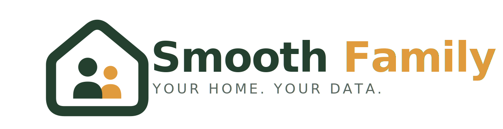
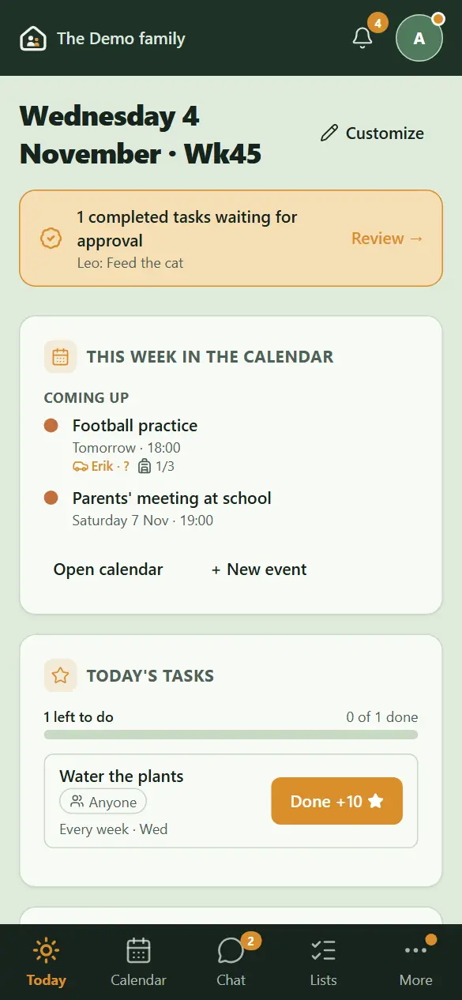
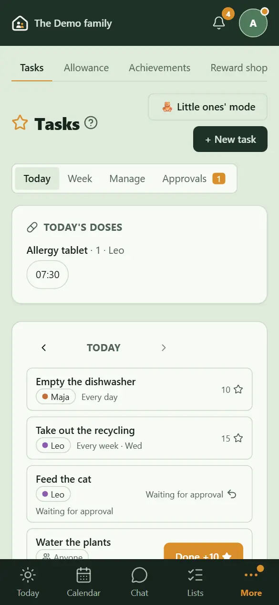
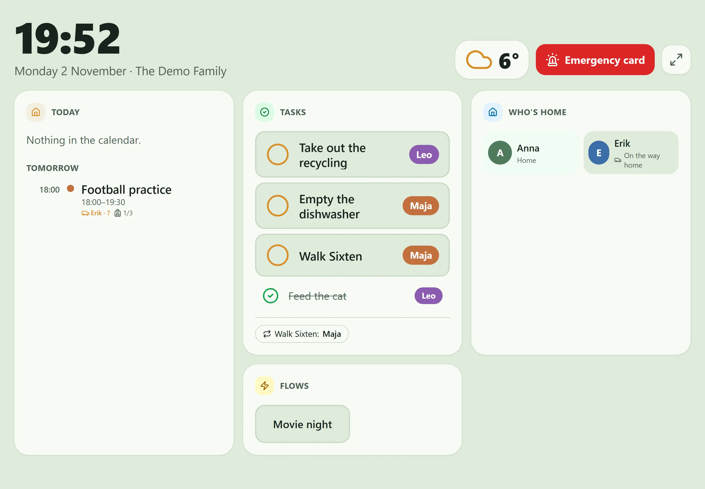

# Smooth Family



**A family's own portal – it runs in your home, not in someone's cloud.**

[The website](https://burnwalled.github.io/smoothfamily/) · [Help centre](https://github.com/burnwalled/smoothfamily/wiki) · [Architecture](#architecture) · [Releases](https://github.com/burnwalled/smoothfamily/releases)

Smooth Family is a self-hosted app for the whole family: the shared calendar, chores with points
and allowance, lists, food and recipes, a kitchen display on the wall, the smart home, the family's
documents and receipts – in five languages, on a phone, a computer or a tablet. It runs on a NAS, a
Raspberry Pi or any computer with Docker, and the family's data never leaves the house unless you
send it somewhere yourself.

| Today | Tasks | The kitchen display |
|---|---|---|
|  |  |  |

## What it does

**The family's day**
- **Today** – the day at a glance: calendar, weather, tasks, dinner, who's home, waste collection,
  school lunch, electricity price, birthdays – each member chooses their own cards.
- **Calendar** – the family's own events and every member's subscribed calendars (Google, Outlook,
  iCloud), month, week and agenda views; who drives and what to pack, two homes for children who
  live in two.
- **Week** – Sunday's look back and ahead: points, the helper of the week, a thank-you star.
- **Chat**, **lists** (shopping, packing, wish lists and secret gift planning) and **notifications**,
  live on every device.

**Children and chores**
- **Tasks** with points, rotation between children, approval by an adult, streaks and achievements;
  tasks several do together share their points.
- **Allowance** from points, a **reward shop**, **savings jars** children propose goals for.
- **The little ones' mode** for children who can't read yet: big pictures, routines step by step,
  a sticker for each.

**Food**
- The week's **meal plan**, the **recipe book** (import from a link), a **cooking mode** in big
  type, the **pantry and freezer** with barcode scanning, shopping lists to the shops' apps through
  Home Assistant.

**The home**
- **Kitchen display** – a tablet on the wall with the day, tasks ticked off by tapping your face,
  dinner and recipes, smart home buttons, and a screensaver (a fox that plays out the weather).
- **Smart home** – Home Assistant directly, or in another home (the cabin) through a gateway that
  needs no open port; flows, presence, energy.
- **Property, vehicles, pets, trips and the household's economy** – maintenance, reminders, costs,
  receipts with warranties.

**Safe keeping**
- **The vault** – photos, documents (passports, insurance) and passwords, encrypted with the
  family's own key; **emergency cards**; guest links for a babysitter or grandparents.

**Running it**
- **Several families on one server**, each its own; the server admin never sees a family's content.
- **Backups** sealed with a key only you hold, **moving** a family to another server, **updates**
  from the app with a rollback if something goes wrong.
- **Local AI** (optional): your own computer reads receipts and suggests meals – nothing goes to
  a cloud AI.
- **Reports** of problems and wishes go to the server admin, who can pass them on to this project.
- **Devices** – which phones, computers, kitchen displays and gateways are connected, and whether
  they're well.

The app has a help centre in five languages (English, Svenska, Norsk, Dansk, Suomi) with a page
and screenshots for every feature – press **?** next to any page's title. The English help is also
in the **[wiki](https://github.com/burnwalled/smoothfamily/wiki)**, to read before you install.

## Made in the Nordics

Smooth Family is built by a Swedish family and works anywhere, in five languages. A few services it
can fetch are Nordic, though: the weather comes from SMHI (the Nordic countries), the electricity
price for Sweden's areas SE1–SE4, the school lunch from Skolmaten and public transport from SL
(Stockholm). Elsewhere those cards simply stay off – everything else works the same.

## Privacy by design

- No accounts with us, no telemetry, no tracking, no fonts or scripts from other servers.
- The only outgoing calls are the ones you turn on: your calendar feeds, the weather (SMHI), the
  electricity price, the school lunch, a product's barcode, a recipe page – and the gateway to your
  own other home.
- Documents and passwords are encrypted with the family's key; backups are sealed with a key made
  in your browser that the server never keeps.
- Children see what is meant for them; adults' own medicines, documents and passwords stay theirs.

## Architecture


One server in the home holds everything: the app, the family's data, photos, the vault and the
backups. The family's devices reach it on the home network; from outside – phones away from home,
guest links, the gateway in another home, calendar apps – only if you open the way, over a VPN or
HTTPS. More in [docs/ARCHITECTURE.md](docs/ARCHITECTURE.md) (the parts and how they talk) and
[docs/ACCESS.md](docs/ACCESS.md) (how to reach it, and what each way costs).

## Install

You need a computer that is always on, with Docker: a NAS, a Raspberry Pi 4/5 (64-bit), a small PC
– or Docker Desktop on Windows or Mac to try it. The app is built from source on that computer the
first time, which needs about 4 GB of memory (it runs in less): on a Raspberry Pi with 2 GB, add
swap first; on a small NAS, build on a PC and copy the images over, as the Synology guide does.

```sh
git clone https://github.com/burnwalled/smoothfamily.git
cd smoothfamily
./scripts/install.sh        # Windows: .\scripts\install.ps1
```

The script writes `.env` with fresh secrets and starts the stack. Open `http://<the-computer>:3000`
and enter the **setup code** the script prints (it is also `SETUP_CODE` in `.env`) – it keeps anyone
else from claiming a new server. A setup guide then helps you set up the server and the family; the
first account becomes the administrator. Keep a copy of `.env` somewhere safe.

- **Synology NAS** (DSM 6/7): [docs/DEPLOY_SYNOLOGY.md](docs/DEPLOY_SYNOLOGY.md) – prebuilt images,
  HTTPS with Caddy, updates and backups.
- **Reaching it from outside**: [docs/ACCESS.md](docs/ACCESS.md) – home network only, a VPN, or
  HTTPS on the internet: what each gives, what it costs, and a checklist before you publish a
  server on the internet. Read it before you open a port.
- **How it fits together**: [docs/ARCHITECTURE.md](docs/ARCHITECTURE.md) – the server's parts, the
  devices and what connects where.
- **Backups**: [docs/BACKUP.md](docs/BACKUP.md) – set them up on day one.
- **Storage**: [docs/STORAGE.md](docs/STORAGE.md) – where the data lives, and moving it.
- **Local AI**: [docs/LOCAL_AI.md](docs/LOCAL_AI.md).

To update: `git pull && docker compose up -d --build` – the database is migrated on start. With
the production stack ([docs/DEPLOY_SYNOLOGY.md](docs/DEPLOY_SYNOLOGY.md) – it runs on any Linux
with Docker), the server can update itself: choose Stable or Beta under Server settings → Updates.

### Stable or beta

Smooth Family comes in two channels:

- **Stable** – the `main` branch and the [releases](https://github.com/burnwalled/smoothfamily/releases)
  (`v3.3.0` …). Fewer, bigger updates that have run in a family's home for a while first. This is
  what `git clone` gives you, and what most families should run.
- **Beta** – the `beta` branch and the pre-releases (`v3.3.0-beta.1` …). The newest changes as soon
  as they are done, tested by the automatic tests but not yet by time. For those who like to try
  things first and report what they find.

To follow beta, switch once and update as usual:

```sh
git checkout beta
git pull && docker compose up -d --build
```

`git checkout main` takes you back to stable at its next release. (Going back to an older version
isn't possible once a newer one has changed the database – keep a backup.) For the Home Assistant
add-on, add `https://github.com/burnwalled/smoothfamily#beta` as the repository instead.

### Home Assistant in another home

The gateway is a Home Assistant add-on (or a small container) that connects out to your server, so
the cabin needs no open port. In Home Assistant OS: **Settings → Add-ons → Add-on store → ⋮ →
Repositories**, add `https://github.com/burnwalled/smoothfamily`, and install **Smooth Family**.
See [gateway/README.md](gateway/README.md).

## Development

Next.js 15 (App Router) and TypeScript in front; FastAPI with async SQLAlchemy 2, Alembic and
Pydantic 2 behind; Postgres 16 and Redis; everything in containers (arm64 and amd64).
See [docs/ARCHITECTURE.md](docs/ARCHITECTURE.md) and [docs/DESIGN.md](docs/DESIGN.md).

```sh
docker compose up -d --build                 # the whole stack on http://localhost:3000

cd backend && python -m venv .venv && .venv/bin/pip install -r requirements-dev.txt
.venv/bin/python -m pytest -q                # backend tests

cd frontend && npm ci
npx tsc --noEmit && npm test                 # types, translations and the help centre
BACKEND_URL=http://localhost:8000 npm run dev

sh scripts/e2e.sh                            # browser tests (Playwright) on a throwaway stack
```

```
backend/     FastAPI app, Alembic migrations, tests
frontend/    Next.js app; src/locales (five languages), src/help (the help centre)
gateway/     the Home Assistant add-on / container for another home
deploy/      Synology stack (compose, Caddy, install, backup, update)
e2e/         Playwright tests
docs/        architecture, design, translations, backups, storage, local AI
scripts/     install, backup, browser tests, help screenshots
```

Translating: [docs/TRANSLATIONS.md](docs/TRANSLATIONS.md). Contributing:
[CONTRIBUTING.md](CONTRIBUTING.md). Security issues: [SECURITY.md](SECURITY.md).

## About this project

Smooth Family is built in spare time by one person and shared for free with anyone who wants it.
Issues and pull requests are welcome and read, but there is no support organisation and no promise
of when an answer or a fix comes.

If it makes your family's days a little smoother, you can buy me a coffee – entirely optional,
and very much appreciated:

[](https://ko-fi.com/Q5O129YE5F)

## License

[AGPL-3.0](LICENSE). Use it, change it and host it for your family. If you offer Smooth Family as a
service to others, your source code – with your changes – must be open under the same license.

(The line at the top of the license – "changing it is not allowed" – is about the text of the
license itself, which nobody may reword. It doesn't limit what you do with Smooth Family's code.)
