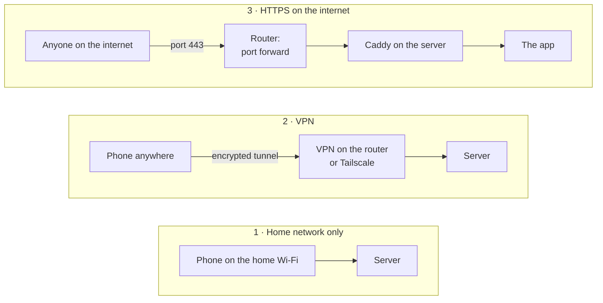

# Reaching the server – the choices and what they cost

Smooth Family runs on a server in your home. How the family's devices reach it is the most
important security decision you make when you set it up. There are three ways, and they can be
combined. The short version:

- **Start with the home network only**, and add a **VPN** when you want the app away from home.
- **Publish the server on the internet only when you need what only that gives** – guest links,
  calendar subscriptions in Google or Apple, a gateway in another home without a VPN, or hosting
  other families – and then follow the checklist below.

See [ARCHITECTURE.md](ARCHITECTURE.md) for the parts of the server.

## The three ways

| | 1 · Home network only | 2 · VPN | 3 · HTTPS on the internet |
|---|---|---|---|
| **The app away from home** | No | Yes, with the VPN on | Yes |
| **Push notifications** | Yes (they go through the push services) | Yes | Yes |
| **Kitchen display** | Yes | Yes | Yes |
| **Guest, wish-list, co-parent and share links** | Only at home | Only for those on the VPN | Yes |
| **Phone calendar subscription** (Google, Apple, Outlook) | Only a calendar app that fetches on the phone, at home – not Google's | Only a calendar app that fetches on the phone itself (not Google's) | Yes |
| **Gateway in another home** | No | With a VPN between the homes | Yes |
| **Hosting other families** | No | Awkward | Yes |
| **Who can knock on the door** | Your home network | Those with a VPN key | The whole internet |
| **Work for you** | None | Set up the VPN once, install it on each phone | The checklist below, and keeping up with updates |

### 1 · Home network only

The server answers only inside the home. Nothing is open from the internet, so a weakness in
Smooth Family or one of its parts can only be used by someone already on your network. Good for
trying it out, and enough for a family that mostly uses it at home and on the kitchen display.

### 2 · VPN

Phones and computers join the home network through an encrypted tunnel, and the server stays
closed to everyone else. Choices:

- **The router's own VPN** – many have WireGuard or a "teleport" built in (UniFi, Fritz!Box,
  Asus, OpenWrt …). Nothing extra to run.
- **WireGuard** on the server or another always-on machine, with one UDP port forwarded – the VPN
  itself is a small, well-reviewed thing to expose.
- **Tailscale / Headscale** – no port at all; Tailscale's coordination server sees which devices
  you have, not your traffic (Headscale is the self-hosted version).

The cost is that every device needs the VPN on, and links meant for people without an account
(a babysitter's guest link, a wish list for grandma) only work for those on the VPN.

### 3 · HTTPS on the internet

The router forwards **port 443** to Caddy on the server, which gets a Let's Encrypt certificate for
your domain (a DDNS name or a CNAME to it is enough). The Synology guide walks through it:
[DEPLOY_SYNOLOGY.md](DEPLOY_SYNOLOGY.md). Everything works everywhere – and the server can be
reached by anyone, including the bots that scan every address on the internet all day.

**Tunnels such as Cloudflare Tunnel** avoid the open port, but the tunnel's company terminates the
encryption and sees all traffic – the family's photos, messages and documents included. That goes
against why Smooth Family runs at home; we don't recommend it.

**A mix** works well: the family uses the VPN (or the home network), and the server is published
only so the things that need it work. It is still published – the checklist applies all the same.

## Before you publish a server on the internet

What's at stake is a family's calendar, children's names and birthdays, photos, messages, documents
and passwords. Treat it like that.

**Only Caddy, only 443**
- Forward WAN **443** to Caddy and nothing else. Never forward the app's own ports (3000, 8000), the
  database (5432), Redis (6379), the NAS's admin pages (5000/5001), SSH or file sharing.
- Leave port 80 closed – the certificate is issued over 443.
- With the plain `docker-compose.yml` (no Caddy), put a reverse proxy with HTTPS in front and set
  `COOKIE_SECURE=true` in `.env`; never publish plain HTTP.
- Set the server's address under **Server settings → Address and services**, so links point to it.

**Sign-in**
- A fresh install can only be claimed with the **setup code** from the install – create the family
  right away anyway.
- Sign-up is by invitation only; there is no open registration.
- Under **Server settings → Security**: keep adults' passwords at 12 characters or more, and turn
  on passkeys and **require** an authenticator app or a passkey for adults.
- Failed sign-ins are throttled (8 per username or 25 per address in 15 minutes).

**Keeping up**
- Install updates as they come (**Server settings → Updates**, and schedule `update.sh` on a
  Synology). An exposed server that isn't updated is the most common way in.
- Watch the operating system too: the NAS's or the Pi's own updates matter as much as the app's.

**When something goes wrong anyway**
- Make the **backup key** on day one and keep backups somewhere other than the server
  ([BACKUP.md](BACKUP.md)) – a copy that a break-in or ransomware on the server can't reach.
- Look at **Server settings → Log** now and then, and at the families' devices: a device nobody
  recognises is worth a question.

**The machine and the network**
- On a NAS: turn off what you don't use (Telnet, FTP, AFP, SMB from outside, QuickConnect), use a
  strong admin password with two-step sign-in, and turn on auto-block.
- If the router can: allow the port forward only from your own country (GeoIP), and turn on its
  intrusion detection.
- A separate network (VLAN) for the server limits what an intruder reaches next – worth it if you
  already run one.

## What to be honest about

- **No software is without bugs.** Smooth Family uses well-known parts (Postgres, Caddy, FastAPI,
  Next.js), a strict Content Security Policy and containers without root – but an exposed server can
  be hit by a weakness nobody knew about yet. Home network or VPN is always the smaller risk.
- **The vault is encrypted with a key the server keeps.** That protects against a stolen disk or a
  copied backup – not against someone who has taken over the running server.
- **Denial of service**: a home connection can't withstand a deliberate flood. Rare against a
  family's server, but publishing makes it possible.
- **Hosting other families** makes you responsible for their data, and you can technically read
  the database. Tell them, and in the EU, think about what the GDPR asks of you.
- **This is a hobby project**, built and shared for free. There is no support organisation behind
  it and no promise of when a fix arrives – which is one more reason to keep the door as small as
  you can.
