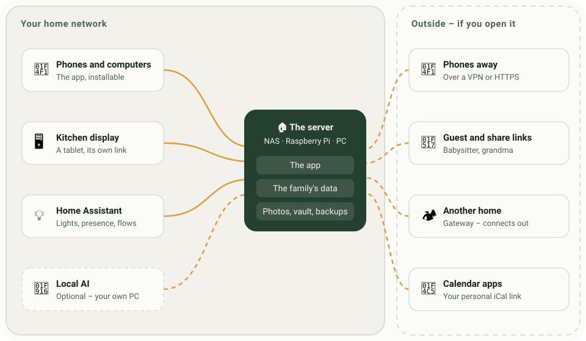
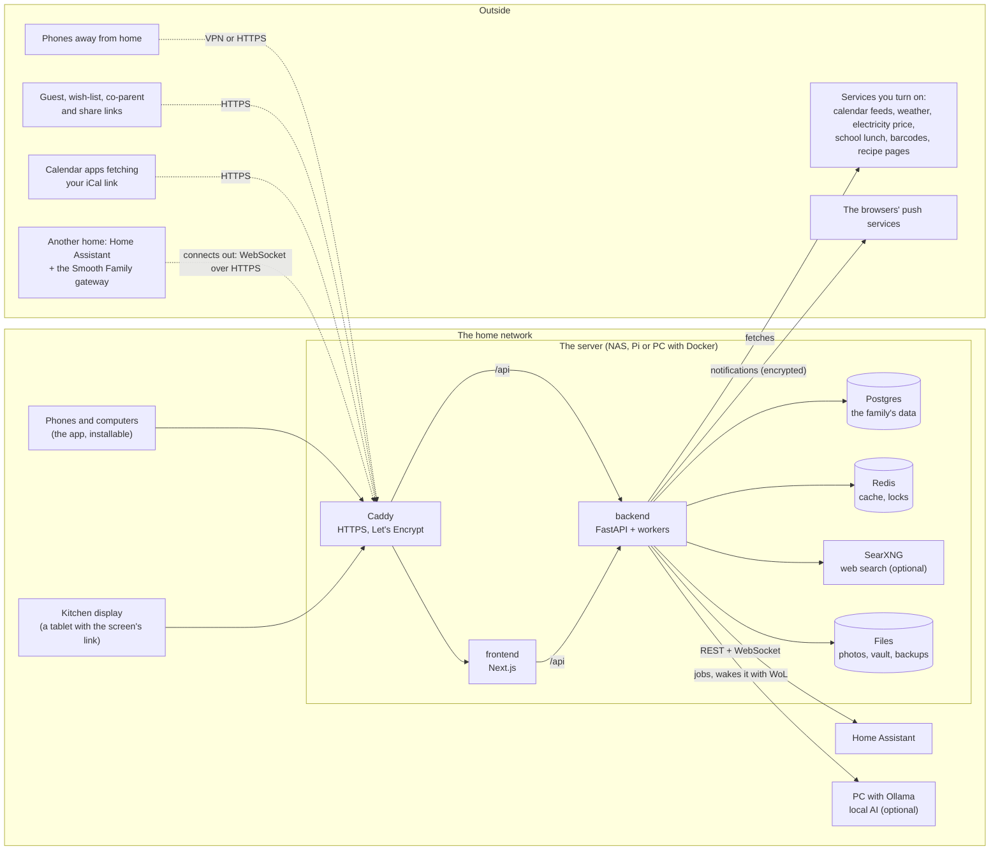

# Architecture

Smooth Family is one server in the home – a NAS, a Raspberry Pi or a small PC with Docker – that
the family's phones, computers and kitchen display talk to. Everything the family keeps lives on
that server. How the devices reach it (only at home, over a VPN or over HTTPS from the internet) is
described in [ACCESS.md](ACCESS.md).

## An environment

Solid lines are always there; dotted ones only when the server can be reached from outside.

## The parts

| Part | What it does |
|---|---|
| **Caddy** | The only door in the production stack (`deploy/synology`): HTTPS with a Let's Encrypt certificate, security headers, `/api` straight to the backend so it sees the real client address. |
| **frontend** | The app (Next.js, App Router). Pages read through a TanStack Query cache kept in the browser's IndexedDB, so a reopened app – or a kitchen display that lost its connection – shows what it had. Ticking list items and tasks works offline and is sent later. |
| **backend** | The API (FastAPI, async SQLAlchemy 2, Alembic). Runs the migrations on start, and the workers: notifications and reminders, the local AI's queue, Home Assistant's live state and the flows. |
| **Postgres** | All of the families' data. Every table has a `family_id`, and every query filters on the signed-in family. |
| **Redis** | Cache for calendar feeds and other fetched data, locks between workers, live events. |
| **SearXNG** | Optional, for recipe and gift searches – on the internal network, reached only by the backend. |
| **Files** | Photos, chat attachments, the vault's documents (encrypted), backups and the update state, under `DATA_DIR`. |

Postgres and Redis sit on an internal Docker network with no way out. The containers run without
root, with their capabilities dropped and read-only file systems where possible.

## Devices and how they connect

- **Phones and computers** use the app in the browser or installed to the home screen. Sign-in is a
  cookie (`httpOnly`, `Secure` behind HTTPS); passkeys and an authenticator app are supported.
- **A kitchen display** is a tablet with the screen's own secret link – no account. It sees only
  what the family admin chose for that screen.
- **Home Assistant at home** is called directly by the backend, with a long-lived token the family
  admin gives it.
- **Home Assistant in another home** (the cabin) runs the Smooth Family gateway, which **connects
  out** to the server over a WebSocket – no open port at the cabin. It needs to reach the server:
  over HTTPS from the internet, or over a VPN between the homes.
- **Guest links, wish lists, co-parents and calendar subscriptions** are links with a secret in
  them. People without an account – and Google's or Apple's calendar servers – open them, so they
  only work from outside when the server can be reached from outside.
- **Push notifications** go through the browser makers' push services (Apple, Google, Mozilla),
  end-to-end encrypted: they see that a message was sent, not what it says.

## Several families on one server

The first family is the server's own; its admin is the **server admin**. Others are invited as
hosted families. The server admin sees their names, sizes and devices by kind – never their
content in the app. Technically, whoever runs the server can read the database; tell the families
you host that, honestly.

## Design decisions

- **Local sign-in**, no external identity provider: an IdP costs memory a Pi doesn't have and is
  more than a family needs.
- **Migrations run on every start.** A self-hosted app can't be hotfixed on people's hardware, so
  every migration must be safe forward: never a destructive change and a data migration in the same
  release.
- **Calendar subscriptions (iCal), not OAuth** – Google, Outlook and iCloud without an app
  registration, cached so the providers aren't asked too often.
- **The browser never talks to third parties.** Anything fetched from outside goes through the
  backend, and only when the family turned it on.
- **English is the source language**; the app is translated in `frontend/src/locales` and the help
  centre in `frontend/src/help`.
- **Themes are CSS variables** switched with `data-theme` on `<html>`.

## The API

Everything goes through the REST API under `/api`. The backend isn't exposed on its own; in
development, add `ports: ["8000:8000"]` to the backend service and open `http://<server>:8000/docs`
for every endpoint.
